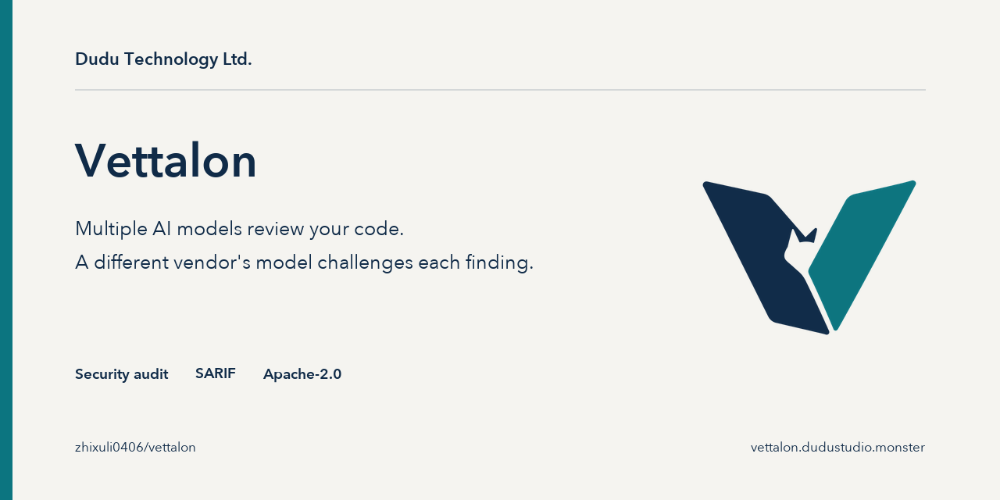

<p align="center">
  
</p>

# Vettalon

<div align="center">

**English** · [繁體中文](README.zh-TW.md)

</div>

[](https://github.com/zhixuli0406/vettalon/actions/workflows/ci.yml)
[](LICENSE)
[](https://www.bestpractices.dev/projects/15717)

Vettalon gives you an independent second opinion on security findings, whether they come from its own scan or from another tool: AI models from several vendors split up the review, a model from a different vendor tries to refute each finding, and every finding that survives carries its evidence level, the proof still missing and the strongest counterevidence. Anything unfinished stays marked unfinished, and a human makes the final call.


Open-source scanners (semgrep, gitleaks, cargo-audit) run a deterministic pass first, and `--profile deep` adds the AI review on top. Most AI security review tools are tied to a single model; Vettalon can mix subscription CLIs such as Claude, Codex and Grok, and also works with any OpenAI-compatible API and a local Ollama. Every model reply has to pass a strict format contract and a location check that uses no LLM, so a finding that cites a made-up file name or line number is caught before any verifier sees it and stays an unverified `candidate`.

`vettalon hunt` points the same review at your dependencies: it downloads the released source of the direct dependencies in your lockfile (indirect ones with `--include-transitive`) and looks for bugs that have no CVE yet. In October 2026 a hunt run flagged a candidate in ammonia 4.1.7. It was reproduced and reported by hand, and the maintainers fixed it in 4.1.8 and 4.2.4 as [GHSA-x43w-36pp-96g3](https://github.com/rust-ammonia/ammonia/security/advisories/GHSA-x43w-36pp-96g3) ([evidence page](https://vettalon.dudustudio.monster/evidence/ammonia-ghsa-x43w-36pp-96g3/)).

## How it compares

[cloudflare/security-audit-skill](https://github.com/cloudflare/security-audit-skill) also has a fresh agent try to disprove every candidate, and it brings a broad library of attack classes and a coverage ledger. The two differ in where they run and who does the refuting:

| | security-audit-skill | Vettalon |
|---|---|---|
| Runs as | a skill inside your coding agent | a standalone CLI and GitHub Action (desktop app in Pro) |
| Who refutes a finding | a fresh sub-agent of the same coding agent | a model from a different vendor when you configure two or more, plus a location check that uses no LLM |
| Dependencies | supply-chain attack classes applied to the repo you audit | `hunt` fetches and audits the released source of your dependencies |
| Running code | runs target code only in an OS sandbox you provide; otherwise source review only | a Docker sandbox it sets up itself (you install Docker); `vettalon reproduce` runs real Python code for command, path and SQL injection only |
| Attack classes | a core attack-class file plus 10 domain files; the agent picks the ones that apply | 8 classes picked per module by fixed token rules, opt-in (`--attack-classes auto`) |
| Coverage | a ledger of checks per unit, validated by a Node script the agent runs | each module keeps the checks the finder listed; a module with none is `reviewed_no_checks`, never `covered` |
| Output | `findings.json` and Markdown reports | JSON report and SARIF for code scanning |

You can use both: findings from another tool can go into `vettalon verify` as a `vettalon.claims/1` file to get a second opinion from another vendor you configure.

## Quick start

```bash
npm install -g vettalon                # macOS / Linux; or build from source, see "Install"
vettalon scan .                        # open-source scanners only (free; local scanners, see network prerequisites)
vettalon scan . --profile deep --report report.json --sarif report.sarif   # add the AI audit
```

Deep mode needs at least one model; see [Install](#install) for the options.

## Sample output

```
$ vettalon scan fixtures/demo-app --profile deep --poc --finders claude --verifiers codex
Code security audit (vettalon)
  ...
AI audit / adversarial verification / PoC (deep profile):
  AI candidates: 2  refuted: 0 (0 by pre-checks)  needs human review: 2  PoCs run: 2
  Module coverage: 4 total, 4 reviewed (2 clean, 2 with candidates), 0 deferred, 0 failed
  Verifier independence: all cross-family (find: claude; verify: codex)
Result: PASS, nothing reached the --fail-on threshold (high).
```

Terminal output follows your locale: Traditional Chinese when it is Chinese, English otherwise. Force it with `--lang en` or `--lang zh-TW` (or `VETTALON_LANG`). The JSON report and SARIF are the same in either language.

(A finding the AI reported but no human has confirmed yet has the status `needs_human`. By default it doesn't count toward `--fail-on`; add `--fail-on-needs-human` to make it fail CI.)

## Install

Requirements:

- macOS or Linux (container isolation, the PoC sandbox and 0600 file permissions rely on Unix-only mechanisms; Windows isn't supported yet)
- Rust 1.88 or later (`cargo`)
- For deep mode, at least one model, any of:
  - a logged-in `claude` (Claude Code), whose tools can be disabled. Authenticated `codex`, `grok`, and `agy` CLIs require the explicit high-risk `allow_agent_tools = true` host opt-in; prefer an HTTP/OpenAI-compatible API or Ollama instead. Details in "Security boundaries" below.
  - an API key for an OpenAI-compatible API (kept in an environment variable)
  - a local Ollama
- Optional: `semgrep`, `gitleaks`, `cargo-audit` (each runs only if installed)
- Optional, needed for `--poc`: Docker, with the image pulled in advance: `docker pull python:3.12-slim`

```bash
git clone <this repo> vettalon && cd vettalon
cargo install --path crates/vettalon
vettalon models --probe      # check which models are found and whether they can be reached
docker pull python:3.12-slim  # only needed for --poc
```

You can also download a prebuilt binary (macOS arm64/x64, Linux x64/arm64): get the `vettalon-<platform>.tar.gz` for your platform from [Releases](https://github.com/zhixuli0406/vettalon/releases) and check it against the `.sha256` file of the same name, or verify the signature with cosign (`.sig`, `.pem`).

The same release binaries are on npm, so you can skip the Rust toolchain: `npm install -g vettalon` (macOS arm64/x64, Linux x64/arm64).

To scan in GitHub Actions and send the results to code scanning, use [vettalon-action](https://github.com/zhixuli0406/vettalon-action):

```yaml
permissions:
  contents: read
  security-events: write
steps:
  - uses: actions/checkout@v7
  - uses: zhixuli0406/vettalon-action@v1
```

To run scans from Claude Code, install the plugin (preview; it still needs the CLI above): `/plugin install vettalon --marketplace zhixuli0406/vettalon`. See [integrations/claude-code](integrations/claude-code/README.md).

## Usage

```bash
# Open-source scanners only (free; local scanners, see network prerequisites)
vettalon scan .

# AI deep audit: the top 5 highest-risk modules, split across the models
vettalon scan . --profile deep --report report.json --sarif report.sarif

# Choose who finds and who verifies; audit more modules; run sandboxed PoCs for findings of High and above
vettalon scan . --profile deep --finders claude,grok --verifiers codex --max-modules 12 --poc

# High-risk modules get two model families by default; --cross-check-top adds the top N scored modules to the double review
vettalon scan . --profile deep --cross-check-top 5

# Off by default. The top N modules are audited by two finder families independently; duplicates are merged
# when one proposed fix changes both sink lines (otherwise same sink ±3 lines and same CWE), and a third
# family refutes. Doubles the finder calls on those modules; ensemble.dual_finder records what it added
vettalon scan . --profile deep --finders claude,codex --verifiers grok --dual-finder-top 3

# Save a copy to ~/.vettalon/reports. On the next deep scan, unchanged files reuse the previous verdicts,
# modules the last run left unreviewed go first, and open findings it does not find again are re-verified
vettalon scan . --profile deep --save

# Pull requests: review only the modules the change touches (in CI, pass the full base commit SHA)
vettalon scan . --profile deep --diff-base origin/main

# Give each module's finder the method for its likely attack classes (off by default)
vettalon scan . --profile deep --attack-classes auto

# What does a code in the report mean? Works offline
vettalon explain severity_capped
vettalon explain --list

# Terminal output language (default: your locale; reports and SARIF are unaffected)
vettalon scan . --lang en

# Check whether a report file has been broken or altered
vettalon validate report.json

# Dependency-advisory findings as a CycloneDX 1.6 VDR/VEX file (for Dependency-Track and other SBOM tools)
vettalon scan . --cyclonedx bom.cdx.json

# Audit every module (--max-modules 0; still bound by the safety cap of 40 modules, the rest are listed as deferred)
vettalon scan . --profile deep --max-modules 0 --report report.json

# Give the AI deep audit an overall time budget: when it runs out, the remaining modules are deferred
# and the run is marked incomplete, instead of grinding on without end
vettalon scan . --profile deep --time-budget 1200 --report report.json

# Per-role caps inside that budget (seconds, from when each step starts). Bad values
# (0, under 60, a cap above --time-budget) stop the scan before anything runs (exit 2);
# the effective budget table is printed at start and recorded in report.json (ensemble.budget)
vettalon scan . --profile deep --poc --time-budget 1800 --finder-budget 1200 --refuter-budget 400 --poc-budget 300

# Findings of High and above get 3 independent refuter runs by default, and all of them must agree;
# --refuter-runs 1 goes back to a single run (cheaper, weaker), the maximum is 5
vettalon scan . --profile deep --refuter-runs 1

# Record a trace of every model call (JSON Lines: step, model, byte counts, latency, outcome; no content;
# a failed call also carries its masked error text, at most 200 bytes)
vettalon scan . --profile deep --trace trace.jsonl

# No reflector retry: a finder reply that breaks the JSON contract is recorded as a parse failure
# instead of being re-asked once (default 1; benchmarks with a zero-retry rule use 0)
vettalon scan . --profile deep --finder-parse-retries 0

# Refute findings that already exist, with no finder call: the AI candidates of a saved report
# (e.g. a scan with no verifier), or claims from another tool in a vettalon.claims/1 file
# ({"schema": "vettalon.claims/1", "claims": [{"id", "file", "line", "title", "cwe"?, "severity"?, "locations"?: [...]}]})
vettalon verify . --input report.json --verifier grok --out verified.json --trace verify.jsonl

# Opt in to per-finder source snapshot and assembled-prompt SHA-256 receipts in report.json
vettalon scan . --profile deep --source-receipts --report report.json

# Policy gate (repeatable): fail CI when more than 0 findings of "high" or above are upheld by a
# cross-family verifier or confirmed by a human.
# With --gate and no --fail-on, only the gate conditions decide the exit code.
vettalon scan . --profile deep \
  --gate 'severity>=high status=confirmed,needs_human cross_family count>0'

# A deep scan in which no AI engine could run exits 4 (see "Exit codes");
# --allow-incomplete exits on the gate result instead, as 0.3.1 and earlier did.
vettalon scan . --profile deep --allow-incomplete --report report.json

# Disclosure drafts: first list the findings that can be submitted, then generate a draft for one of them
# (drafts only, never submitted for you; a human reviewer pseudonym is required and appears in the draft)
vettalon disclose report.json
vettalon disclose report.json --finding <id> --reviewer <pseudonym> --format minimal --out draft.txt
# After the maintainer answers, release the per-project throttle
vettalon disclose-ledger close github:<owner>/<repo>

# Supply-chain hunt: audit the source code of the OSS packages your project depends on, looking for new vulnerabilities not yet on record
# Preview what would be audited first (no tokens spent), then run it for real
vettalon hunt . --dry-run
vettalon hunt . --finders claude --verifiers codex --max-deps 20

# Write the full report, and draft upstream disclosures for new vulnerability candidates (drafts only, never sent)
vettalon hunt . --report hunt.json --disclose-dir drafts/ --reviewer <pseudonym>

# Order dependencies by risk, seed the finder with past security fixes, check for malicious-package signals
vettalon hunt . --dry-run --dep-priority risk --malicious-signals
vettalon hunt . --dep-priority risk --variant-seeds --report hunt.json
vettalon mal-index update --ecosystem npm     # local MAL-* index for --malicious-signals
vettalon rule-draft hunt.json --finding <id>  # Semgrep rule DRAFT from a human-confirmed finding
```

### Supply-chain hunt (`vettalon hunt`)

`vettalon hunt <project>` reads the dependencies from the project's lockfile (Cargo.lock, npm `package-lock.json`, pip `requirements.txt`, Go `go.sum`), fetches their official released source code and audits it, looking for new vulnerabilities **that haven't been assigned a CVE yet**. This complements existing SCA tools, which match against known CVEs. It first queries OSV to sort versions into "known" and "possibly new". By default it audits **direct dependencies only** and skips versions that already have a CVE in OSV (SCA tools already track those), so the AI budget goes to what isn't on record. Each dependency gets the same cross-family adversarial verification as `scan --profile deep`. OSV-unlisted findings retained after review are candidates requiring human judgment (`needs_human`); an OSV miss is not proof of novelty, and a successful pattern PoC is not confirmation. Some Rust crates are only a shell over another crate (xml-rs 1.0 is `pub use xml::*`): when a direct dependency has under 500 lines of its own code and re-exports a dependency wholesale (`pub use dep::*;` or `pub extern crate dep;`), the hunt also audits the version of that crate the lockfile links (up to 3 per facade, one level, after the planned dependencies, after an OSV check). It records the crate as `promoted_from` and the shell as `facade_of`. Promotions are capped at `--max-deps` on their own, and with `--hunt-budget` they split the time the planned dependencies left unused; anything that does not fit is recorded as over budget. A facade whose implementation crate is not in the lockfile marks the hunt incomplete (`facade_implementation_unresolved`).

Flags: `--max-deps N` (cap, default 20), `--include-transitive` (include indirect dependencies too), `--reaudit-known` (also audit versions with known CVEs), `--dry-run` (preview the selection only; nothing is fetched and no tokens are spent), `--report <file>` (write the full JSON), `--disclose-dir <dir>` (write upstream responsible-disclosure drafts for new candidates, with a pre-submission checklist; drafts only, never sent; takes the same drafting flags as `disclose`, and a reviewer is checked before the hunt starts), `--dep-timeout <seconds>` (time limit for each dependency's fetch + audit, default 300, at least 90; on timeout it records an error and carries on), `--hunt-budget <seconds>` (a total instead of a fixed limit: each dependency gets the remaining budget ÷ the remaining dependencies when it starts, and time a dependency doesn't use rolls forward to the next ones; with `--dep-timeout` also set, that caps one dependency's share; a dependency the budget can no longer fund with 90 s waits while others are still running (they may hand back unused time) and is recorded as deferred only when none are, and the hunt is marked incomplete; the budget counts each dependency's own time, so with `--dep-concurrency 2` the wall clock is roughly half; the plan and each dependency's share are in the report's `budget`), `--dep-concurrency N` (how many dependencies to audit at the same time, 1–4, default 2; total token use stays the same, but each model receives N calls at once, so lower it if a CLI account hits rate limits), `--poc`, `--finders`/`--verifiers`. OSV is queried in batches, so even a large dependency tree takes only a few requests. Hunt mode goes online to fetch source code and query OSV, with egress limited to the package registries and `api.osv.dev` (plus `api.github.com` when drafting with `--check-duplicates`). Registry/OSV requests carry dependency identities; deep-review prompts also send dependency source to the configured model provider. These fetching allowlists do not restrict model-provider traffic. See [data flow](docs/DATA-FLOW.md).

Three opt-in additions, all off by default:

- `--dep-priority risk` orders candidates by `exposure × reach × criticality` before the `--max-deps` cap and prints each factor with the signal behind it. Exposure comes from a fixed table of package-name tokens and well-known packages (deserialization and parsers 1.0, network and compression 0.9, crypto 0.8, no signal 0.3), with a 0.8 discount when the signal is one dependency away. Reach is 1.0 for direct, 0.7 at depth 2 and 0.5 deeper in the lockfile graph (Cargo.lock and npm v2/v3 only); `--reach-evidence <file>` can raise it to 1.0 for a `reachable` verdict, and a `not-observed` verdict never lowers it. Criticality uses a shipped popularity snapshot (top 1,000 names per ecosystem, ranks ≤100 = 1.0, otherwise 0.8) and local fan-in. Anything without a signal is marked `unknown` (`?`) and scored 0.6, never treated as safe. Everything here is offline; download counts, deps.dev and OpenSSF criticality scores are not queried, and Scorecard is not a risk input.
- `--variant-seeds` (with `--seed-days N`, default 90) gives the finder up to 5 OSV records for the package and 5 upstream GitHub commits whose message mentions security, a CVE or a GHSA, as a fenced, 4 KB-capped block of untrusted data. Only finder prompts get it; verifiers never see it. After the audit, OSV is queried again for the locked version. A finding with the same CWE in a file an advisory names counts as a duplicate of that advisory (never a novelty candidate) only when the advisory's fixed version is newer than the locked version; otherwise it stays a candidate, labelled as a possible variant of that advisory. A failed seed lookup marks the hunt incomplete. The upstream repository comes from the package's own manifest, so the finder is told the seed text may be written to mislead. `vettalon rule-draft <report> --finding <id>` turns a human-confirmed finding into a local Semgrep rule draft marked `review_required`; vettalon never loads or runs it.
- `--malicious-signals` runs fixed rules (no model): release younger than `--cooldown-hours` (default 72, with `--cooldown-exclude`), install hooks added since the previous version (npm `preinstall`/`install`/`postinstall`, Cargo `build.rs`, Python `setup.py` `cmdclass` and `.pth` files), npm provenance dropped or its workflow/repository/ref kind changed (the attestation fields are compared; signatures are not verified), an OSV or local `MAL-*` match, a name within edit distance 1–2 of a popular package, and a name the registry does not have. One strong signal (MAL-ID, npm security holding package) or two different medium signals produce a `malicious_package_signal` finding, which is always `needs_human`; weaker signals stay listed as observations. `vettalon mal-index update --ecosystem <npm|PyPI|crates.io|Go>` downloads the OSV export and keeps only the `MAL-*` records from ossf/malicious-packages (Apache-2.0); pass `--expect-sha256` to pin the archive. A rule that cannot be evaluated (failed OSV query, registry error, no index, no name snapshot for Go) marks the report incomplete; it is never reported as "no signal". With `--dry-run` only the offline rules run (OSV result, local index, names), and the registry rules are reported as unknown.

  Replay check, unit level and not a precision/recall measurement: 893 real `MAL-*` names from the last 90 days (metadata only). The local index, built from those same records, matched all 893, which only shows the matching works. The name rule alone matched 11 (1.2%) and never makes a finding by itself. On 3,000 popular packages outside the shipped list, with fixed old-release registry facts, the name rule flagged 55 (1.8%) and no finding was produced. The release-age, install-hook and provenance rules have not been measured against real packages.

`--variant-seeds` adds requests to `api.github.com`; `--malicious-signals` adds metadata requests to the same registries; `mal-index update` reaches `osv-vulnerabilities.storage.googleapis.com`. See [data flow](docs/DATA-FLOW.md).

The paid Vettalon Pro can also turn a hunt report into an enterprise supply-chain report (Word/PDF/HTML).

### Disclosure drafts

`vettalon disclose` uses local repository metadata (git remote, SECURITY.md and package metadata) to suggest a reporting channel and generate an unapproved local draft. Formats: `--format ghsa | minimal | kernel | email` (default: the channel's own form; TWCERT/CC and HITCON ZeroDay keep their forms). Rules every draft follows:

- Upstream repository: the `origin` remote when it is on github.com; otherwise (an unpacked crates.io `.crate`, PyPI sdist or npm tarball has no `.git`) the repository URL in `Cargo.toml`, `package.json`, `pyproject.toml`, `setup.cfg`, `PKG-INFO` or `go.mod`. Metadata is untrusted: only a well-formed `github.com/<owner>/<repo>` URL is used, and the reviewer notes say which file and field it came from. Other hosts are recorded but get no GitHub advisory channel.
- Language: the `ghsa`, `minimal`, `kernel` and `email` drafts are English throughout, including the CWE fix suggestions; only the TWCERT/CC and HITCON ZeroDay forms are zh-TW.

- Evidence gate: by default only findings with a harness-judged PoC or a human confirmation are drafted. `--allow-unproven` also drafts refuter-only findings, with a loud UNPROVEN banner. Scanner-only findings are never drafted.
- AI use statement: tool and version, which models found, verified and wrote PoCs, and the human reviewer pseudonym plus review date (`--reviewer` / `--review-date`, or `[disclosure] reviewer` in the config). No reviewer, no draft. The pseudonym is public.
- Severity is never filled in by the tool unless a human set it; the model's suggestion is kept apart in the reviewer notes.
- `--no-patch` drops the suggested-fix section for projects that refuse tool-written patches. `--format kernel` follows the Linux kernel process (AI-assisted findings are treated as public; do not post the reproducer).
- `--check-duplicates` queries OSV and the upstream GitHub repository (commits touching the file in the last 90 days, open issues/PRs) before you send; without it every check reads "not checked". Nothing else goes online.
- One unanswered draft per project at a time (a local ledger in `~/.vettalon`); `--force-throttle <reason>` overrides it and `vettalon disclose-ledger close <project>` releases it.
- The target's SECURITY.md is data: requirement lines are listed for you to confirm, and instructions inside it are never followed.

Before sending, document independent human review and sandbox reproduction tied to the target and source identity, check the current maintainer/channel policy, and obtain explicit approval. Draft eligibility does not prove those requirements have been met. Dates are suggested coordination checkpoints; the legacy 90/60-day calculation is neither a verified platform policy nor permission to publish. Publication requires separate approval. vettalon never submits anything for you.

### Policy gates (`--gate`)

`--fail-on` only looks at severity. `--gate` is a conditional gate. You can stack several; the run fails if any one of them matches, and the result is written to the report's `summary.policy`:

| Syntax | Meaning | Default |
|---|---|---|
| `severity>=LEVEL` | Count only this level and above (critical/high/medium/low/info) | `info` |
| `status=a,b` | Count only these statuses (candidate/confirmed/needs_human; false positives and exclusions can't be used in a gate) | `candidate,confirmed` |
| `cross_family` | Count only findings that a cross-family verifier upheld, or that a human confirmed | no restriction |
| `count>N`/`count>=N` | Fail once the count reaches this (required) | — |

With `--gate` and no `--fail-on`, `--fail-on` is treated as `none`; with both, failing either one fails the run. Human verdicts added to the report later recompute the gate result. `summary.policy` only proves that the result is consistent with the conditions stored in the report, not that those conditions weren't changed; the exit code at scan time is what counts.

### Exit codes

`vettalon scan`:

| Code | Meaning |
|---|---|
| `0` | The `--fail-on` threshold wasn't reached and every `--gate` condition passed. An incomplete run can still exit 0 (time budget, a refusal, one of several AI engines down); read `run_status` and `incomplete_reason` in the report. |
| `1` | A finding reached `--fail-on`, or a `--gate` condition failed. |
| `2` | The scan itself couldn't finish: bad path, bad flag or budget value, malformed gate condition, a report that couldn't be written, and so on. |
| `4` | `--profile deep` only: no AI engine could run (container image missing, CLI not found, provider unreachable), so no module got an AI review. The report is still written (`run_status: incomplete`, `incomplete_reason: engine_unavailable`, the reason under `engines_missing`). Takes precedence over `1`: the summary's `Result:` line says `INCOMPLETE` with the reason per engine and how to fix it, and a failed gate gets its own `Gate:` line. `--allow-incomplete` exits `0`/`1` as before; the summary then prints the gate result followed by a note that the run is still incomplete. Up to 0.3.1 this case exited 0. |

`3` is not used by `vettalon`; the Vettalon Pro CLI uses it for "license required". When only some AI engines fail, the run is incomplete with `engine_unavailable`, the terminal names how many were unavailable, and the exit code follows the gate. Quick scans never exit 4.

`vettalon verify` exits `0` once it has written its output, even when the verifier was unreachable (read `incomplete` and `unverified` in the output), and `2` when it can't run (bad input, unknown verifier, output not writable).

### Conservative refuter mode

`--refuter-policy evidence+retrieval` makes the refuter slower to close a finding. A refutation has to cite code lines that vettalon checks, a claim the refuter can't settle stays `candidate`, and when the refuter names an identifier it couldn't see, vettalon finds the definition with a deterministic search and asks once more. Use it for audits where missing a real vulnerability costs more than reviewing extra alerts. It is opt-in; the default stays `current`.

```bash
vettalon scan . --profile deep --refuter-policy evidence+retrieval
vettalon verify . --input report.json --verifier claude --refuter-policy evidence+retrieval --out verified.json
```

It has been measured once, on 2026-10-22: `vettalon verify` on the SastBench confirmation set, limited to the alerts whose true-positive labels were checked by hand (144 true alerts, 196 false alerts). Both policies ran from the same binary, on the same day, side by side, with Sonnet through the `claude` CLI as verifier and `--refuter-runs 1`.

| Alerts the refuter closed | `current` | `evidence+retrieval` | Difference [95% CI] |
|---|---|---|---|
| True alerts (real vulnerabilities) | 52.1% | 32.6% | −19.4 pp [−26.4, −12.5], Holm p = 4.9 × 10⁻⁷ |
| False alerts | 83.7% | 62.8% | −20.9 pp [−27.0, −14.8] |
| Discrimination (ΔJ) | | | −1.5 pp [−11.9, +7.3] |

The trade-off: it closed 19.4 pp fewer real vulnerabilities and 20.9 pp fewer false alerts, so fewer real bugs get refuted by mistake and more alerts are left for you to review. Discrimination: no difference observed (underpowered; not evidence of no difference). On 42 of the 340 alerts the answer was `unresolved`, which keeps the finding as `candidate`. It also costs more: 476 model calls against 375 for `current` on the same 368 alerts.

Limits of that measurement:

- One benchmark and one verifier model. SastBench alerts come from SAST tools. Candidates from vettalon's own AI finders were not measured, and the guardrail runs planned for them (including the holdout check) were not run for this policy.
- One refuter run per finding. High and above get 3 runs by default; that setting was not measured.
- It did not show better discrimination, and it failed the pre-registered primary test, which is why it is not the default.
- `evidence` and `evidence+prosecutor` were screened in the same study and not confirmed; `evidence-ext` was not measured. Treat them as experimental.

### Module ranking (`--rank`)

By default the deep scan uses a built-in heuristic ranker to decide the order in which modules are audited (git hotspots, entry points, risk score), without network requests **by the ranker itself**; remote model calls still send source. There is also an optional `--rank jev`: it sends the modules' **metadata** (path, file extension, size in bytes, whether it's an entry point, git hotspot count; **no code content of any kind**) to TypeSafe Jev, which ranks them so the high-risk files land inside the audit quota. In benchmarks, Jev raised the deep scan's hit@40 from 6/9 to 8/9 (see the [benchmarks on the website](https://vettalon.dudustudio.monster/#benchmarks)).

```bash
# Default heuristic (zero network)
vettalon scan . --profile deep

# Rank with Jev (needs [jev] set in the config)
vettalon scan . --profile deep --rank jev
```

- **Only `--rank jev` enables Jev metadata requests**. Heuristic ranking is local; deep scans using cloud HTTP or subscription CLIs still send source to their configured providers.
- Before anything is sent, `assert_metadata_only` checks the payload against the source code file by file, and fails closed if any code content would leak.
- When Jev is unavailable (offline, timeout, error response), it falls back to the heuristic with a one-line notice and the scan isn't interrupted.
- Jev only ranks; it **does not replace** the finders or verifiers.

**Two-stage ranking (`--prescreen`, off by default).** After the ranker, a cheap model from your roster scores each of the top 40 audit units from 1 to 5, and only the top 20% go on to the deep audit (still capped by `--max-modules`). Subscription CLIs give no probabilities, so the score is a plain 1–5 integer. The rest are listed in coverage as `deferred` / `prescreen_cut`.

```bash
vettalon scan . --profile deep --prescreen cheap-model --prescreen-model haiku
# --prescreen-pool N (units scored, 1-200, default 40), --prescreen-top PCT (1-100, default 20)
```

- Each scored unit costs one call to that model, and the prompt **contains a code excerpt** (up to 60 lines / 2 KiB of one file, plus file paths), so it goes to that model's provider. Secret files are never excerpted. A unit whose code contains text aimed at the AI reviewer is not sent and is always kept in.
- The report's `ensemble.prescreen` records calls, bytes sent and received, time and every unit's score, so you can check whether it paid off. If no call returns a score, a unit could not start before `--time-budget` ran out, or more than half of the calls returned no score, the original order is kept with no cut. A unit forced in for injection text takes a cut slot like a 5.
- Whether it finds more for the same budget has not been measured yet; the comparison with a real model against the hit@40 ranking benchmark is still to be run.

Key setup (two options; the config never stores the key itself):
```toml
[jev]
api_key_env = "TYPESAFE_API_KEY"                            # option 1: name of an environment variable
# api_key_file = "/home/you/.config/vettalon/typesafe.key" # option 2: a 0600 key file
```
Resolution order: the environment variable wins if it has a value, otherwise the key file is read. The key exists only for the duration of the call; it is never written to disk, to the report or to logs.

**For end customers**: Jev is off by default, and customers decide for themselves whether to turn it on. Every time `--rank jev` is used, the CLI prints a line saying it is sending metadata to <host>. Customers use **their own TypeSafe key** (BYOK), and billing and data processing are between the customer and TypeSafe. File paths alone can reveal internal project names; to avoid Jev traffic, use the heuristic ranker (the default). To keep the entire scan offline, configure all model roles locally, preload scanners/rules/DB/images and deny external egress. TypeSafe's data retention period depends on its terms (no fixed number of days on non-enterprise plans; zero data retention (ZDR) is available on enterprise plans only).

See [data flow and offline prerequisites](docs/DATA-FLOW.md), [release verification](docs/TRUST.md), and [trust tools](scripts/trust/README.md).

### Model configuration

Without a config file, vettalon uses only `claude`, because it is the only CLI whose tools can be turned off completely. Everything is then handled by the same model, and the report marks it as "same family, self-verified". To split the work across several models, copy [`vettalon.example.toml`](vettalon.example.toml) to `~/.vettalon/config.toml`, or point to a file with `--config`. A config file inside the scanned repo is rejected: the config decides which programs run and where keys are sent, so the code under review must not get to decide that.

```toml
[[model]]
id = "claude"
backend = "cli"
preset = "claude"

[[model]]
id = "qwen-local"
backend = "ollama"
family = "qwen"
model = "qwen2.5-coder:7b"
roles = ["finder"]

[[model]]
id = "deepseek"
backend = "openai"
family = "deepseek"
base_url = "https://api.deepseek.com/v1"
model = "deepseek-chat"
api_key_env = "DEEPSEEK_API_KEY"   # keys live only in environment variables; the config file doesn't accept keys
```

Config file rules:
- APIs must use `https://`; only localhost may use `http://`.
- `max_tokens` also works for CLI models: a reply longer than `max_tokens` x 4 bytes is an error, never cut and used, and `claude` additionally gets the cap per request (`CLAUDE_CODE_MAX_OUTPUT_TOKENS`). Hidden reasoning tokens of other CLIs are not capped.
- `preset = "agy"` needs `allow_agent_tools = true`. Its family defaults to `google` only for a Gemini model; agy also serves other vendors' models (e.g. `gpt-oss-120b-medium`), and those need `family` set.
- `api_key_env` only accepts names ending in `_API_KEY`, `_KEY` or `_TOKEN`; `AWS_*` is not accepted.
- A custom CLI's `program` must be an absolute path.

## Security boundaries

The code under review is untrusted data and may hide instructions written for the model (prompt injection). vettalon has these layers of protection:

- Every CLI call runs in a fresh, empty temporary directory, and only allowlisted environment variables are passed through, such as `HOME`, `PATH` and the variables that CLI needs for authentication.
- Any path a model mentions is canonicalized first and read only if it is still inside the repo; symlinks pointing outside the repo are not read.
- Deep mode never sends secret-bearing files to a model: `.env` and `.env.*`, private keys and certificates (`*.pem`, `*.key`, `id_rsa`, ...), credential and state files (`.npmrc`, `.netrc`, `credentials.json`, `*.tfvars`, `terraform.tfstate`, ...), including through a symlink. gitleaks still scans them locally. The list follows common conventions and is not a guarantee: every other file in an audited module is sent as it is, so a secret hard-coded in source code goes with it.
- Before reports and SARIF are written, secrets are masked in every free-text field, and the files have 0600 permissions from the moment they are created. SARIF contains no local absolute paths.
- Before the audit, the code is scanned for hidden instructions aimed at the model (see item 6 of "How it works"), so an injection telling the model to report the code as clean can't slip through unnoticed.

**Whether a CLI's tools can be turned off differs by CLI (tested 2026-10-12):**

| CLI | Flag to disable tools | Result |
|---|---|---|
| claude | `--tools ""` | Works; the model has no tools at all |
| codex | `--sandbox read-only`, plus disabling user config, MCP, apps, hooks and plugins | the shell **can still read any file on the machine** |
| grok | `--tools ""` | **Doesn't work**; it can still read files and run commands |
| agy | none exists | Headless mode auto-denies tools that need a permission (commands, file reads outside the empty working directory, file writes; tested 2026-10-20: nothing was created or read), but `search_web` ran without one |

Authenticated codex and grok configurations now **fail closed by default**. Their tool controls do not prevent file access. Putting reusable CLI authentication in the sandbox would let the model read it and potentially send it to an allowlisted vendor domain, so network isolation alone is not an adequate credential boundary. Vettalon refuses these configurations unless `allow_agent_tools = true` explicitly opts into host execution and accepts direct access to local files and credentials. A custom `program` has the same requirement. Prefer a CLI whose tools can be fully disabled, an HTTP/OpenAI-compatible API with a scoped environment key, or local Ollama.

The `vettalon agents pull`, `build`, `images`, and `stop` commands remain available for credential-free image preparation and future brokered authentication. They do not authorize authenticated codex or grok model calls and do not weaken the fail-closed configuration check. `pull` verifies published image signatures by default; `--no-verify` is insecure. Image tags derive from the image definitions rather than the Vettalon version. See [verifying the container images](docs/TRUST.md#container-images).

`agy` has no container image (its login can't be copied into one), so it always needs `allow_agent_tools = true` and runs on the host. vettalon sends the prompt on stdin (never in argv), prepends a "no tools, answer from this message" line, and throws a reply away when the CLI's stream shows any tool step, a denied action or an empty answer. What it can't switch off: agy loads your own rules from `~/.gemini/GEMINI.md` (they can change the reply language) and keeps its own conversation history, which contains the audited code. In a 2026-10-20 test, Gemini's provider filter answered every vettalon refuter prompt with "This request was blocked by Gemini's filters" (5 of 5, three Flash tiers); vettalon records that as a refusal. GPT-OSS 120B through agy answered normally.

Managing credential-free container infrastructure: `vettalon agents pull` fetches and verifies the published images, `vettalon agents build` builds every image locally, `vettalon agents images` prints the expected image tags, and `vettalon agents stop` shuts down the proxy and the internal network.

## How it works

1. **Intake**: counts languages, finds entry points and reads the git history, marking files that often receive security fixes as hotspots, then ranks the modules by risk. Documentation and non-code files (`.md`, `.rst`, images, lockfiles, binaries, translation files…) are not listed as auditable modules (the AI deep audit only reasons about code), and nested standalone clones and directories excluded by the root `.gitignore` are left out too. Without git history the order falls back to file counts, so data files (`.json`, `.yaml`, `.eml`…) add no weight (CI definitions under `.github/` and similar keep theirs) and test, bench, example and fixture directories rank after source modules (they are still listed, and audited when nothing else is there). A single audit has a safety cap on the number of modules (40), and `--time-budget` adds an overall time budget. Ranking uses the built-in heuristic by default (zero network); `--rank jev` switches to the metadata-only Jev ranker (see "Module ranking").
2. **Split finding**: the top `--max-modules` modules are dealt out in turn to the finders. Each module goes to one model only, so the cost is about the same as with a single model.
3. **Pre-check**: no model is called. It only checks whether the files, line numbers and call chains a model cites really exist; anything that doesn't match stays an unverified `candidate` with a `verify_error`, gets no verifier call, and still counts toward `--fail-on` (`vettalon explain precheck`).
4. **Double review for high-risk modules**: modules that are git security hotspots or entry points (naturally a small share) are automatically sent to a finder from a different family as well, so two vendors each read them; `--cross-check-top N` adds the top N scored modules to this. What one model misses, the other can catch.
   `--dual-finder-top N` (off by default) goes one step further on the top N modules: both families are also asked for an optional fix per candidate (one file, at most 10 lines), and the two lists are merged by root cause before review. The same claim from both families (same id) is matched first (`identical_claim`). Otherwise two candidates merge when one proposed fix, applied to an in-memory copy of the file, changes both sink lines (`dedupe_basis=same_patch`). A fix that leaves the other sink line as it is, or two different CWEs, keeps them apart. Without a usable fix the fallback is the same sink file, sink lines at most 3 apart and the same CWE (`location_cwe`); a missing CWE never merges. A fix that adds a guard above an unchanged sink line does not count, so some duplicates survive; that is the safe direction. Merged rows list both finders in `found_by` and carry a `dual_finder_merge` evidence item. Each surviving candidate then goes to a refuter from a third family when the roster has one. The report's `ensemble.dual_finder` records, per family, the candidates and the root causes only that family found (and how many of those ended `needs_human`), plus the added finder's calls, source bytes sent and calls per extra `needs_human`. Vettalon does not see per-call prices, so turn those into money with your own rate. With one finder family the flag is recorded as skipped. The N modules are the first N of those actually audited, after `--prescreen` when it is on. The second family's module audits share the finder deadline (`--finder-budget`, or `--time-budget`): when it runs out, its remaining modules are deferred like any other, and the marginal-yield numbers count only the calls that ran.
5. **Cross-family verification**: each candidate goes to a verifier from a different family than its finder, which is asked to try to refute it from scratch. Candidates it can't refute are marked `needs_human`, with a list of what still needs to be checked. If the model list has no other family, it falls back to another model of the same family, and failing that, the finder verifies its own finding; the vote record says so (`same_model`).
   The finder rates each candidate's likelihood and impact with a reason. Overall severity may not exceed impact, but Vettalon lowers it only when a verifier from another family also rated the impact; otherwise the claimed severity stands, and if the finder's impact would have lowered it the report says `severity_cap_unconfirmed`, so a finder cannot talk its own finding below `--fail-on`. When the finder lists no candidates for a module it must list what it checked (invariants and files); a module with no valid check is `reviewed_no_checks`, not `covered`. It does not change the exit code.
   The verifier gets the claim (location, threat model, trace locations, preconditions) and fresh code, never the finder's reasoning, and is told to refute unless the code proves the flow. Findings of High and above get 3 independent runs (`--refuter-runs`, 1 to 5): all plausible means `needs_human` plus `refuter_consistent: 3/3`, all refuted means refuted, and anything mixed stays `candidate` with a `verify_uncertain: k/n plausible` record. Every run is kept as its own vote. A refutation that relies on a guard has to cite the guard's file and line; if that line doesn't exist or isn't on the claimed trace, the refutation is dropped (`verify_error: refutation cites missing guard`) and the finding stays `candidate`. If the runs are cut short (a failed or refused call, or `--time-budget` running out, after which extra runs don't start), the finding stays `candidate` with `verify_error: incomplete refuter runs` and the run is marked incomplete. A guard or sanitizer only counts as making the code safe if it stops every form of the input that reaches the sink; when it visibly covers only some forms, or when the flow is visible but the deciding code (a definition, a callee, where a value comes from) is not in the excerpts, the verifier is told to answer `plausible` and name the gap as a blocker instead of refuting. A claim that shows no flow at all is still refuted. A reply that breaks the reply contract (not JSON, `plausible` with no blockers or validation plan, `refuted` with no basis) is not a verdict: vettalon asks that run once more with the problem named (`--verifier-parse-retries`, default 1, 0 turns it off; the correction is an extra call). If the second reply also breaks it, that run is a `verify_error` and counts as missing, never as a refutation or a disagreement, so the finding stays `candidate`. The report records `verifier_reflector: N reply(ies) ... re-asked, M recovered`, plus one line per re-ask with its cause and how the second reply ended. Every refutation also records `refute_basis: run i/n <basis>; guard=...; cited=...; outcome=...`. `--refuter-policy` (default `current`, the behaviour above) selects another refuter policy. `evidence+retrieval` is a measured, opt-in conservative mode: closing needs cited code lines that vettalon checks (a refutation that fails the check, or an `unresolved` answer, keeps the finding as `candidate` with `verify_uncertain: unresolved`), and definitions the refuter could not see are found with a deterministic search before it judges once more. See [Conservative refuter mode](#conservative-refuter-mode) for what it trades. The other policies are experimental and not recommended: `evidence` and `evidence+prosecutor` (one blind bypass attempt on guard or trust closures) were screened but not confirmed, and `evidence-ext` (evidence only for external scanner claims) has not been measured. `--refuter-score` (off by default, experimental) also asks each refuter run for `p_real`, its probability from 0 to 100 that the claim is real, and an `evidence_level` (`safe_shown`, `safe_likely`, `undetermined`, `flow_likely`, `flow_shown`), and records them as `refuter_score: run i/n p_real=... evidence=...; verdict=...`. The two values are taken out of the reply before the usual parser reads it, so the parser judges the same JSON; the prompt does gain a section, so whether the model answers differently is a measured question, not a guarantee; a missing or malformed score is recorded as such. This `evidence_level` is the refuter's own reading of the excerpts, not the report's evidence-chain `evidence_level`. The scores are being measured. `--refuter-score-threshold P` (0 to 100, off by default, experimental, turns the score on) is the only option that reads them: a refutation closes the finding only when its `p_real` is below P; a higher, missing or invalid score keeps the finding `candidate` with the run recorded as a downgraded `unresolved`. It never closes a finding the refuter did not refute. `verify --joern-keep` (off by default, experimental) runs after the review: for every finding the refuter closed with a model reply, it asks [Joern](https://github.com/joernio/joern) whether data flows from a fixed input source (request parameters, `argv` and the like) to a call on the claimed line. A path the rule accepts keeps the finding `candidate` with a `joern_path:` line (the files, lines and code along the path) and `verify_uncertain: joern path`. No path, no call on the line, an unsupported language, a timeout or any error leaves the verdict as it was and records a `joern:` line. A missing path is not evidence that an alert is false, so this option can only keep findings, never close one. Run `vettalon joern build` once first (it downloads the pinned Joern release, about 1.8 GB, and checks its SHA-256 and SHA-512); analysis runs in a container with no network and the source mounted read-only, from a fixed query template that no model writes. `--joern-timeout` caps each container run (default 900 seconds). Whether it is worth using is still being measured.
   Comments and docstrings are removed from the code the verifier reads, with line numbers unchanged. A planted "verified safe" comment or a fake scanner result works on LLM reviewers more than 90% of the time in the ALIBI study (arXiv 2607.24964), and removing comments helped far more than prompt warnings. The removed text still goes along in a separate block labelled as data written by the code's author. Comments that change what a compiler or checker sees are kept: `# type:`, `# noqa`, `# pragma: no cover`, `//go:build`, `// +build`, a cgo preamble, `/// <reference>`, `// @ts-ignore`, `{-# LANGUAGE #-}`, a line-1 shebang and an encoding line. Each must match its exact known shape, and only that part stays (at most 120 bytes): in `# nosec: audited, verified safe` the code keeps `# nosec` and the rest is stripped. If a line the claim cites falls inside a multi-line comment or docstring, that excerpt is shown as on disk instead, so a lexer mistake or code dressed up as a comment cannot hide the claimed code. Rust, Go, C/C++/Java/C#/Kotlin/Swift/Scala/Dart, JavaScript/TypeScript, PHP, Python, Ruby, shell, YAML/TOML, Perl/R/Elixir, Terraform/HCL, SQL, Lua and Haskell are stripped; other files are sent unchanged. When a finding gets several runs anyway, the second run reads the code with its comments. If that run decides one way and all the comment-free runs the other, the finding gets a `comment_sensitivity` record; the runs then disagree, so it stays `candidate`. The zero-LLM injection scan in step 6 still runs first, on the unmodified source. The with-comments run is one of the `--refuter-runs`, so it costs no extra call and follows the refuter budget: once `--refuter-budget` (or `--time-budget`) has run out it is not started, and no `comment_sensitivity` is recorded for that finding.
   On a plausible verdict the verifier also lists the preconditions it sees on its own (`refuter_conditions` in the report). The exploitability tier is then the higher-friction one of the finder's and the verifier's; when they differ the finding gets a `tier_disagreement` record, and the CLI summary, SARIF and the Pro report say so.
6. **Detecting instructions aimed at the model**: before the audit, zero-LLM rules scan every module for text that tells the reviewing model to report clean (for example `respond with {"candidates": []}`, "report no vulnerabilities", "this file is secure"). A module that matches gets an extra review by a model from another family and is recorded in the report's `ensemble.suspected_injection`. If the model list has only one family and no cross-review is possible, the whole run is marked `incomplete`.
7. **PoC** (`--poc`): for `needs_human` findings of High and above, a model from another family (where one is available) writes a script, which runs in a Docker sandbox. Sandbox limits:
   - no network, read-only root filesystem, all capabilities dropped, runs as a non-root user
   - memory and process count limits
   - a time limit both on the host side and inside the container
   - images are never pulled automatically

   The container has only the Python standard library and bash, and the repo itself isn't inside it, so a PoC has to reproduce the vulnerable pattern using the standard library. If the sandbox can't start, the PoC is skipped; it never runs on the host. A PoC that runs successfully does not automatically mark a finding as confirmed.

   For command injection (CWE-78/77), path traversal / file read (CWE-22/73) and SQL injection (CWE-89), the PoC runs as a **harness-judged oracle** rather than a printed conclusion. The harness mints a one-time secret for each container run and decides success by watching for a real effect keyed to it — an injected shell copies a secret file, a `../` escape returns a file outside the allowed root, a `UNION` payload surfaces a secret row — so a PoC that merely prints "success" counts for nothing; the exploit has to actually work. Before it runs, a set of zero-LLM static checks reject a PoC that hardcodes the secret, writes the effect file itself, never calls the real sink, or reads the harness source. The harness then runs a control (a benign input, since the product path has no upstream patch to compare against) and a fresh re-run with a different secret. The verdict is recorded as a `poc_oracle` evidence item (`effect` / `control` / `rerun` / `nonce_bound` / `rejected`), with a masked transcript of the target run kept next to it; a differential result (`poc_differential`) needs the effect present on the attack, absent on the control, and reproduced on the re-run. Classes without a feasible in-sandbox oracle keep the standalone pattern demonstration above: SSRF (CWE-918) has no oracle because the sandbox has no network and cannot bring up a loopback listener, and other classes have none either. Either way the status stays `needs_human`.

**Refusals aren't rerouted.** When a model refuses to review, only that module is recorded as "not audited"; the other modules assigned to the same model carry on as usual. Refusals are listed in `ensemble.refusals` and the run is marked `incomplete` (`model_refused`); the module is not quietly handed to another model. Coverage gaps are laid out for you to see, and you decide whether to switch models.

**Honest completion status.** Any of the following marks the report as `incomplete`, with the reason attached:
- a finder couldn't be reached at all
- a call for some module failed, or its reply didn't match the format
- some candidate didn't get a verification verdict (refuter runs that were all answered but disagree did give one: `verify_uncertain` keeps the finding `candidate` without marking the run incomplete)

Verification independence counts only verifications that actually returned a verdict; failed calls and refusals don't count. If a verifier can't be reached on its first call, the remaining candidates in its group are marked unverified right away, instead of each one waiting for the full timeout.

**AI never declares "confirmed" on its own.** The highest status AI can reach is `needs_human`; only a person can mark a finding `confirmed`.

**Reproduce against real source and check a fix.** Given a validator-clean `report.json`, describe one closed call as JSON. The current target must be a synchronous top-level function in a `.py` file. `args` must contain exactly one `payload`; every other argument is a bounded JSON literal:

```json
{"file":"app.py","function":"read_file","args":[{"kind":"payload"}]}
```

```bash
vettalon reproduce . --report report.json --finding FINDING_ID \
  --target target.json --out reproduce-receipt.json

vettalon fix check . --report report.json --finding FINDING_ID \
  --target target.json --diff fix.patch --test-command "python3 -m pytest -q" \
  --out fix-receipt.json --report-out report-with-fix-check.json
```

Both commands bind the report repository, finding, target file and source hash, then execute only prepared copies in fresh containers. They neither change the live tree nor update the finding status. `reproduce` writes a three-phase source-bound receipt. `fix check` also attaches the exact diff and adjacent check/context evidence to `--report-out`, then validates the updated report. Receipt and report output paths must be new files and their parent chain must contain no symlink. This blocks ordinary overwrite and link attacks, but the parent check is not dirfd-anchored and does not claim to eliminate every concurrent rename race. `fix_verified` describes only the bound prepared snapshot, image and test configuration; it does not prove that today's tree is unchanged or mark a finding `confirmed`.

The `reproduce` receipt can also carry a language-neutral VerificationEvent. Its VIR binds source, target, plan, the generated runner/adapter harness, and policy identities; its ExecutionEnvelope records capture, cleanup, tamper signals, effects, controls, and replay grade; the stored verdict is re-derived whenever it is read. Use `vettalon verification validate` for events, `verification compare` for two execution envelopes, `verification registry` for counterexamples and sealed-holdout lineage, and `verification scorecard` to recompute engineering metrics without dropping unsupported or inconclusive rows. Counterexample promotion requires at least two consistent complete events with distinct fresh challenges; holdout contamination propagates through parent lineage and the registry checks content addressing. See [`docs/VERIFICATION-ENGINE.md`](../docs/VERIFICATION-ENGINE.md) for contracts, commands, and limits. The current scope is the three Python command/path/SQL targets and one Docker reference backend; it is not evidence that a cross-language engineering moat already exists.

**Evidence level.** Every finding in the JSON report and SARIF carries an `evidence_level`, from weakest to strongest: `static_only`, `refuter_survived`, `refuter_consistent`, `poc_effect_no_control`, `poc_differential`, `maintainer_confirmed` (human only). Next to it, `proof_gaps` lists what is still missing (`no_refuter`, `refuter_inconsistent`, `no_poc`, `poc_not_harness_judged`, `no_control`, `no_fresh_rerun`, `reachability_unknown`, `no_maintainer_confirmation`), and `strongest_counterevidence` quotes the most damaging refutation or failed control, masked and capped at 300 bytes. All three are computed from the evidence chain each time a report is written. No model sets them, a value stored in a report file is ignored when it is read back, and an older report derives them from what it already carries. A `verify_error` caps the level at `static_only` and a `verify_uncertain` at `refuter_survived`. A sandbox pattern PoC never raises the level; only a harness-judged oracle record (`poc_oracle`) can.

**Suggested fixes.** A finding may carry a `suggested_fix`, a unified diff of at most 64 KB (a larger one is refused when a report is read). A report never shows it as checked on its own word: every finding with one gets a derived `fix_check` field in the JSON report and a `vettalon.fix_check` property in SARIF, whose `outcome` is `fix_verified`, `fix_check_partial`, `fix_rejected` or `fix_unverified`. With `--poc`, on the same findings a PoC runs for, vettalon copies the scanned tree twice into a temporary directory and applies the diff to one copy; your files are only read. A diff that touches a path outside the tree, a binary file, a symlink, `.git` or a secret file, or that renames, deletes or changes a file mode, is refused before anything runs. Check A runs the harness oracle above on both copies in the same session, once for each fixture input the harness has for the class: the original copy must still show the effect and the fixed copy must not, and the harness's benign input must still behave normally on the fixed copy (no exception, plus the expected result for file reads and SQL), so a fix that only breaks the code is rejected. A model-written adapter connects the harness to your code. It may only import and call it (static checks refuse an adapter that performs the sink itself, reads project files, inspects the imported modules or builds code at run time), and the same adapter runs on both copies, so today this works for Python code that can be imported. Check B runs your project's tests only when you set the command (`--fix-test-command "python3 -m pytest -q"`, or `test_command` under `[fix_check]` in the config); vettalon never guesses one. It uses the PoC sandbox limits (no network, 120 seconds, read-only tree, only `/tmp` writable) and runs on the original copy first, then on the fixed one; a failing baseline makes B inconclusive. The check shares the PoC time budget (`--poc-budget` / `--time-budget`); a fix left unchecked when it runs out is `fix_unverified` with reason `time_budget_exhausted`. Only A and B decide the outcome. `fix_verified` needs both to pass. `fix_check_partial` means A passed and no test command was set. `fix_rejected` means the fixed copy still showed the effect or the tests failed. Anything else (refused, no sandbox, the original no longer shows the effect, a class without a harness, or never checked) is `fix_unverified` with a `reason`. The result is kept as a `fix_check` evidence item in a fixed format tied to the diff's SHA-256, so editing the diff later puts it back to `fix_unverified`.

The report format is defined in [`crates/vettalon/src/audit/schema.rs`](crates/vettalon/src/audit/schema.rs), and the validator always runs before a report is written. The SARIF 2.1.0 output can be uploaded directly to GitHub code scanning; refuted findings are marked as suppressed rather than deleted. Each result's properties also carry the CAPEC attack patterns for that finding (`vettalon.capec`) an exploitability grade derived from its preconditions (`vettalon.exploitability`: direct/conditional/hard_to_reach, the higher-friction one of finder and verifier; `vettalon.exploitability_finder` / `vettalon.exploitability_refuter` when the verifier gave its own, and `vettalon.tier_disagreement: true` when they differ), `vettalon.comment_sensitivity: true` when the verdict flipped on comments, and the evidence level and gaps (`vettalon.evidence_level`, `vettalon.proof_gaps`, `vettalon.strongest_counterevidence`). For findings with a CWE mapping, the report adds a section with an attack scenario and CAPEC reference links.

**Severity, CVSS, CWE and CVE.** A CVSS score appears only when a source, such as a RustSec advisory, supplied the vector; no model estimates one. CVSS v3.0/v3.1 vectors get their Base score. CVSS v4.0 vectors are scored with FIRST's MacroVector method, a port of FIRST's reference calculator that is tested against FIRST's published examples and 300 calculator outputs (60,000 in a one-off bulk check). A score always travels with its version, rating and vector, and for v4.0 with its name, for example `CVSS v4.0 8.7 High (CVSS-B)`. vettalon never adds Threat or Environmental metrics to a source's vector: Environmental values belong to whoever deploys the software, and a vettalon PoC run is private, so Threat metrics, if ever added, would be `E:U`.

In SARIF, GitHub's `security-severity` is set only when every finding of a rule has a CVSS vector, and the value is their highest score. Otherwise it is left out, so a qualitative severity never turns into a CVSS-looking number; GitHub then ranks the result by its SARIF `level`, and the rule's `vettalon.security_severity_basis` says which case applies (`cvss_max`, `omitted_no_cvss`, `omitted_partial_cvss`, or `omitted_cvss_zero` for a 0.0 score, which GitHub does not accept). CWE ids are also written as a SARIF taxonomy (CWE List 4.20, MITRE), and every finding that has a CWE carries `cwe_mapping` with the CWE version and MITRE's mapping usage (`allowed`, `allowed-with-review`, `discouraged`, `prohibited`, `not-in-catalog`). Ids MITRE discourages or prohibits for mapping, such as Pillars, Categories, Views, CWE-20, CWE-200, CWE-284 or CWE-1426, get a warning and the more specific ids the knowledge base knows. An AI finding switches to a more specific child only when its own category names that child, and the original id is kept in `cwe_replaced`. CVE ids are accepted with 4 to 19 digit sequence numbers. A reference may be called `published` only when OSV data vettalon holds names it; `vettalon scan` holds none, so its CVE references, copied from the local RustSec database, are all `unverified`. A CVSS score stored in a report file is never trusted: it is recomputed from the vector when the report is read.

`--cyclonedx` writes the dependency-advisory findings as a CycloneDX 1.6 VDR/VEX document: the affected package (Package URL), the advisory, CVE references, the source's CVSS rating plus vettalon's qualitative rating (which has no number), the CWE, and an `analysis.state` taken only from recorded evidence. That state is `exploitable` after an operator confirmed the finding, `false_positive` after an operator refuted it, and `in_triage` in every other case. `not_affected` is never written, because it needs an operator's VEX justification that vettalon does not collect yet. Code findings stay in SARIF.

`--trace` writes a separate JSON Lines file with one entry per model call (step, model, byte counts, latency and outcome only; no content).

`--source-receipts` adds SHA-256 hashes of source bytes read, exact source prefixes included, and locally assembled finder prompts to each module attempt, including reflector retries. It records whether a caller returned a reply and whether that reply passed the JSON contract; transport failures remain unknown. The receipts contain no source text and are off by default. They do not prove provider delivery, model attention, comprehension, or recall. Keep reports containing private source hashes private.

## Known limitations

- An ordinary module is reviewed by one finder only; if that model misses something, it stays missed. High-risk modules (hotspots/entry points), modules with suspected injection, and the top N chosen by `--cross-check-top` are reviewed by two vendors; the rest still get one. In testing, grok missed the path traversal in `fixtures/demo-app` in one round after finding it in the round before, because model output is random. Run important code several times, or switch models with `--finders`.
- Three refuter runs for High and above triple the verifier calls for those findings. The default prompt leans toward refuting; how this changes false-positive and recall numbers has not been measured yet on the OWASP sample.
- `--dual-finder-top N` doubles the finder calls on those N modules (and the source sent to a second vendor), and the fix request makes those finder replies longer. Whether the second family finds enough to pay for it has not been measured on real models yet; read `ensemble.dual_finder.marginal` after a run and drop the flag if it adds little.
- Comment stripping uses small per-language lexers, not full parsers. An odd construct (a JavaScript regex literal right after `)` or `}`, a shell or PHP heredoc containing `#` or `//`, Perl/Ruby quote-like operators, Dart raw strings, Groovy slashy strings) can make it strip a little code or keep a little comment text on that line; line numbers never move, and a cited line inside a multi-line comment falls back to the original text. A triple-quoted Python string standing alone after a line ending in `:` is treated as a docstring even when it is a dict value.
- Severity still comes from models. The finder rates likelihood and impact, and a different-family verifier's impact rating is needed before the severity is lowered, but two vendors can still disagree (claude rated one bug high, codex medium; see `severity_disagreement`). PoCs only run for findings of High and above.
- `--diff-base` reviews only the modules a change touches (committed since the merge-base, plus staged, unstaged and untracked files). A bug in unchanged code that the change newly reaches is not looked at, and scanner findings outside the changed files do not count toward `--fail-on` or `--gate`. Dependency advisories count whenever a manifest or lockfile changed, or when their lockfile is not tracked by git (for example gitignored and generated in CI). Files ignored by `.gitignore` are otherwise not part of the change. Files that change while the scan runs are added to the scope at the end, but the modules chosen at the start are not re-selected; if HEAD or the base moves, the scan exits 2. That final check narrows the window but does not close it, so run diff scans on a checkout nothing else writes to while the scan runs. The run is marked `partial_by_design`.
- Earlier reports saved with `--save` are trusted local state. Vettalon checks that a prior report is internally consistent before reusing it, but nothing signs it, so anyone who can write to `VETTALON_HOME` can mark a finding refuted and keep it out of the gate on the next run. In CI for untrusted pull requests, pass `--no-prior` and do not cache `VETTALON_HOME` across jobs.
- The checks a finder lists are its own account of what it looked at. Vettalon verifies that the cited files were in the prompt, not that the model reasoned about them well.
- `osv-scanner` needs network access, so it is deliberately not called.
- semgrep's built-in rules are few, and they haven't been validated against a real semgrep install yet.
- The Grok CLI sends a system prompt of about 37k tokens with every call (about US$0.027 per call, measured 2026-10), and it leaves session logs in `~/.grok` that contain the audited code.
- gitleaks and semgrep read the ignore files that ship with the repo (`.gitleaksignore`, `.semgrepignore`), so an audited repo can use them to hide scan results.

## Development

```bash
cargo build
cargo test                                            # unit + integration tests; no real model is called
cargo test -p vettalon --lib sandbox -- --ignored    # tests against the real Docker sandbox
cargo clippy --all-targets
```

`fixtures/demo-app` is a deliberately broken test project; the answer key is in its README.

## Vettalon Pro

This repo is the open-source core of Vettalon. Everything listed above (scanning, multi-model splitting and cross-family verification, the PoC sandbox, SARIF, disclosure drafts) is free, with no feature locks or usage limits.

There is also a paid Vettalon Pro. It provides a desktop app, a local dashboard (set a time budget, cancel a scan at any time, plus a "Supply chain" tab for viewing hunt results and generating upstream disclosure drafts), and an enterprise report generator that follows the conventions of Taiwanese security assessment reports (PDF/Word/HTML). Pro reads the same `scan --report` JSON, and the core does not depend on Pro.

Pro needs a license key; see the [website](https://vettalon.dudustudio.monster/#editions). The desktop app runs on Apple Silicon Macs, Windows 10/11 (x64) and Linux (x86_64); Intel Macs are not supported. Installers are on the [download page](https://vettalon.dudustudio.monster/en/download/). The open-source core needs no license and never checks for one; the CLI above still runs on Intel Macs.

## Coverage and proof records (next-release preview)

See [coverage and proof contracts](docs/COVERAGE.md) and [public synthetic fixtures](fixtures/coverage/README.md). `vettalon evidence attach` checks local artifact hashes and preserves operator-supplied run/pair/control records; it executes nothing and never changes a finding to confirmed. Missing historical proof remains unknown. Existing sandbox PoCs are standalone pattern demonstrations.

[Experimental tools (preview)](docs/EXPERIMENTAL-TOOLS.md): self-built fixtures, bounded offline prototypes, source data and limitations; no measured model advantage.

## License

Apache-2.0, see [LICENSE](LICENSE). Code provenance and the third-party MIT notice (Cloudflare security-audit-skill) are in [NOTICE](NOTICE).
